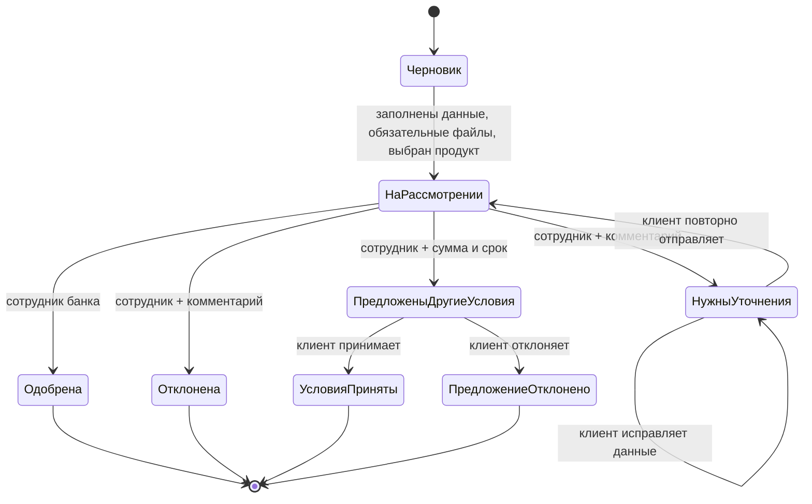

# Жизненный цикл заявки

Черновики сохраняются при изменении формы и не удаляются через интерфейс. Повторная отправка доступна только для статуса `needs_info`. Одобренную или отклонённую заявку нельзя редактировать; клиент может создать новую. Каждый этап записывается в `application_events` и показывается в кабинете обеих сторон.

| Статус API | Отображение клиенту | Действие |
|---|---|---|
| `draft` | Черновик | Продолжить заполнение |
| `pending` | На рассмотрении | Ждать решения сотрудника |
| `needs_info` | Нужно уточнение | Исправить данные и повторно отправить |
| `approved` | Одобрено | Посмотреть решение и комментарий |
| `rejected` | Отказано | Посмотреть пояснение; при необходимости создать новую заявку |
| `offer_made` | Банк предложил другие условия | Сравнить платёж и принять/отклонить предложение |
| `offer_accepted` | Условия приняты | Ожидать связи сотрудника для следующих шагов |
| `offer_declined` | Предложение отклонено | При необходимости создать новую заявку |

Документы обязательны при отправке: выписка ЕГРЮЛ/ЕГРИП, бухгалтерская отчётность и справка о налоговой задолженности. Дополнительные документы необязательны. MVP принимает PDF, PNG и JPEG до 10 МБ и проверяет сигнатуру файла.
