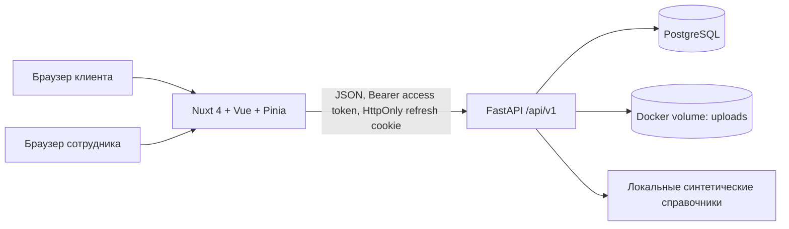

# Архитектура MVP

## Состав

Все части запускаются локально через Docker Compose. Pinia — единая точка для API-вызовов на клиенте; action включает/выключает состояние загрузки через `try/catch/finally`. Сервер проверяет владельца заявки и роль сотрудника на каждом защищённом маршруте.

## Компоненты

- `frontend/`: кабинет клиента и рабочее место сотрудника банка.
- `backend/`: FastAPI, схемы запросов, авторизация, расчёты, документы и миграции.
- PostgreSQL хранит пользователей, компании, заявки, историю решений и каталог продуктов.
- Docker volume `uploads_data` хранит загруженные документы; `postgres_data` — состояние базы.

## Решения и границы MVP

Расчёт предложений — детерминированная демонстрационная логика, а не подключённая языковая модель. Ежемесячный платёж рассчитывается по формуле аннуитетного платежа. Список продуктов, компании для поиска по ИНН и отраслевые подсказки синтетические. Нет интеграции с ФНС, БКИ, банковским скорингом или платным AI API. Каждое предложение показывает расчёт и факторы, а финальное решение принимает сотрудник в отдельной роли.

Access JWT короткоживущий; refresh token хранится в HttpOnly cookie и ротируется при обновлении. При локальной работе cookie не Secure; для HTTPS-публикации установите `REFRESH_COOKIE_SECURE=true`, настройте origin и замените все демонстрационные секреты.

## Наблюдаемость и восстановление

- `GET /healthz` проверяет подключение API к PostgreSQL.
- Ошибки API возвращаются единым объектом `error` с кодом, сообщением и полями.
- Перезапуск контейнеров сохраняет базу и файлы в именованных Docker volumes.
- Миграции из `backend/migrations/` применяются по порядку и регистрируются в `schema_migrations`.
