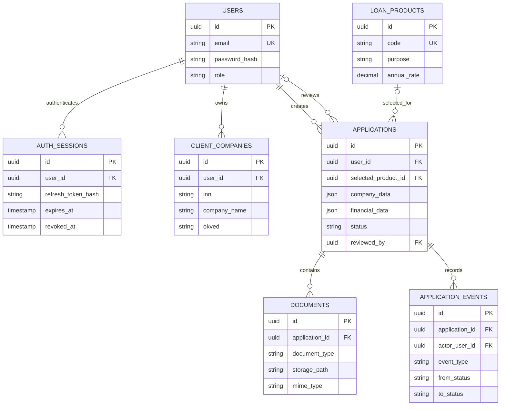

# Модель данных

`company_data` и `financial_data` — JSONB снимок сведений именно на момент заявки; справочник компаний можно обновлять отдельно, не меняя прошлые заявки. Файлы вне БД, в таблице находятся метаданные и путь в приватном volume. Внешние идентификаторы ФНС/БКИ не хранятся, так как интеграций в MVP нет.
